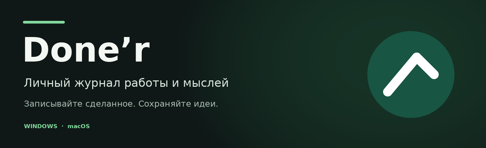

<p align="center">
  
</p>

<p align="center">
  <strong><a href="https://github.com/imolchanof/doner-downloads/releases/latest/download/Doner.exe">Скачать для Windows</a></strong>
  &nbsp; · &nbsp;
  <strong><a href="https://github.com/imolchanof/doner-downloads/releases/latest/download/Doner-macOS-universal.zip">Скачать для macOS</a></strong>
</p>

<p align="center">Windows 10/11 · macOS 13+ · Intel и Apple Silicon</p>

## Чтобы к вечеру помнить, на что ушёл день

Весь день были заняты, а вспомнить конкретные результаты трудно. Done’r помогает вести короткие записи по ходу работы: что закончили, чем занимаетесь сейчас и какие идеи хотите сохранить.

Приложение живёт рядом с часами. Откройте его, напишите пару строк и вернитесь к работе. Потом записи пригодятся для отчёта, обзора недели или просто чтобы увидеть, сколько уже сделано.

## Три типа записей

- **Что сделано?** Завершённые дела и результаты. Например: «Отправил клиенту предложение».
- **Что делаю?** Текущая работа. Например: «Готовлю новую рекламную кампанию».
- **Мысль.** Идеи, которые не хочется потерять. Например: «Проверить другой заголовок объявления».

В настройках можно включить напоминание «Что делаешь сейчас?» и выбрать удобный интервал. Есть черновики и четыре темы оформления.

**Записи остаются на вашем компьютере.** Приложение работает без аккаунта и интернета, сохраняет историю в обычные текстовые файлы с датой и временем.

## Начать пользоваться

**Windows**

[Скачайте Doner.exe](https://github.com/imolchanof/doner-downloads/releases/latest/download/Doner.exe), положите в удобную папку и запустите. Установка и права администратора не нужны. Значок появится в трее рядом с часами; если его не видно, откройте скрытые значки стрелкой.

**macOS**

[Скачайте архив](https://github.com/imolchanof/doner-downloads/releases/latest/download/Doner-macOS-universal.zip), распакуйте и перенесите `Done'r.app` в «Программы». После запуска значок появится в верхней строке меню.

> **При первом запуске:** сборки пока без доверенной подписи издателя; на macOS также нет нотариализации Apple. Система может показать предупреждение. На Mac используйте штатное подтверждение в «Системные настройки → Конфиденциальность и безопасность», если доверяете источнику. Не отключайте антивирус или защиту системы. Если антивирус сообщает об угрозе, не продолжайте запуск и сообщите автору.

<details>
<summary>Где лежат записи, как обновиться и проверить файл</summary>

### Ваши записи

- Windows: `%LOCALAPPDATA%\DoneLog`
- macOS: `~/Library/Application Support/Doner`

Каждый месяц приложение создаёт отдельный текстовый журнал. Перед обновлением закройте приложение и сделайте копию папки с записями, затем замените программу новой сборкой. Папку с данными удалять не нужно.

### Требования

Windows 10/11 с .NET Framework 4.x или macOS 13 Ventura и новее. Сборка macOS универсальная: подходит для Intel и Apple Silicon.

### Проверка скачанного файла

[Контрольные суммы SHA-256](https://github.com/imolchanof/doner-downloads/releases/latest/download/SHA256SUMS.txt) помогают проверить целостность скачивания.

Windows, PowerShell:

```powershell
Get-FileHash .\Doner.exe -Algorithm SHA256
```

macOS, Терминал:

```bash
shasum -a 256 Doner-macOS-universal.zip
```

Сравните результат с файлом контрольных сумм из той же версии. Это проверка целостности, а не замена подписи издателя или антивируса.

</details>

---

[Сообщить об ошибке](https://github.com/imolchanof/doner-downloads/issues) · [Все версии](https://github.com/imolchanof/doner-downloads/releases)

При сообщении об ошибке укажите вашу систему и что произошло. Личные записи прикладывать не нужно.
